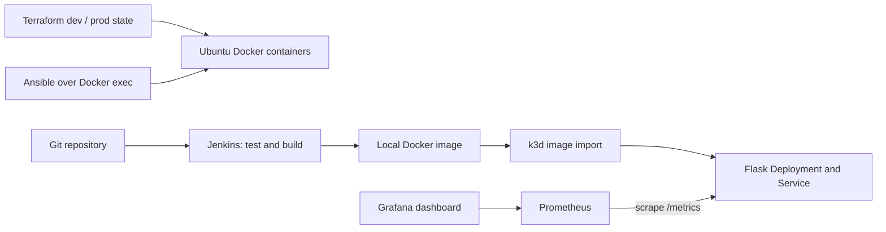

# devops-mini-lab

A small, local DevOps apprenticeship lab for macOS and Docker Desktop. One Flask
application, one Ubuntu training container per Terraform environment, one k3d
server, Jenkins, Prometheus and Grafana. No database, cloud account or registry
account is required. “prod” is a second local training environment, not a production service.

## How it fits together



Terraform manages the Linux practice containers and their networks. It deliberately
does not manage the k3d cluster or Jenkins. Ansible configures only the dev Ubuntu
container. Jenkins uses Docker's local socket to build an image and stream it into
the single k3d server's containerd; kubectl then rolls out that image. Prometheus
scrapes the app inside Kubernetes; Grafana reads Prometheus. There is no central
log storage: use Docker, kubectl and Jenkins console logs.

## Files

```text
.
├── app.py, requirements.txt, requirements-test.txt, requirements-dev.txt
├── Dockerfile, .dockerignore, .gitignore, Jenkinsfile
├── tests/                 # endpoint and manifest contract tests
├── terraform/
│   ├── main.tf, variables.tf, outputs.tf, versions.tf, .terraform.lock.hcl
│   ├── environments/      # dev.tfvars, prod.tfvars
│   └── modules/linux/     # network, registry data source, image, container
├── ansible/
│   ├── ansible.cfg, inventory.ini, playbook.yml, requirements.yml
│   ├── vars/              # YAML variables and encrypted dummy Vault example
│   └── roles/common/      # tasks, handlers, Jinja2 templates
├── jenkins/               # tooling Dockerfile and Compose definition
├── k8s/                   # namespace, deployment, service, config, dummy secret
├── monitoring/            # Prometheus, Grafana provisioning and dashboard
├── scripts/               # setup, test, tf, ansible, deploy, smoke, monitoring,
│                          # jenkins and cleanup
└── docs/                  # evidence, criteria, troubleshooting, validation
```

Generated state, kubeconfigs, reports, virtualenvs and local credentials are ignored.

## Install on a Mac

Install [Docker Desktop](https://docs.docker.com/desktop/setup/install/mac-install/)
for your Mac architecture and start it. Allocate approximately 4 CPUs, 6 GB RAM
and 15 GB disk to this lab (allow more for image caches). Docker Desktop's built-in
Kubernetes is not required. Install [Homebrew](https://brew.sh/) if absent, then:

```bash
brew tap hashicorp/tap
brew install hashicorp/tap/terraform k3d kubectl python@3.12 git
# Use Python 3.12 for the pinned Ansible controller dependency.
export PATH="$(brew --prefix python@3.12)/libexec/bin:$PATH"
python3 --version
terraform version
docker info
k3d version
kubectl version --client
# From your clone, not a new Git worktree:
cd 5.2-local-devops-practisces
```

Tested tool targets are Terraform 1.11.4, k3d 5.8.3, kubectl 1.31.5 and Python
3.12. Homebrew installs current tools; pin kubectl and k3d for this lab after
entering the repository (the downloads below preserve checksum verification):

```bash
mkdir -p .local/bin
case "$(uname -m)" in arm64) LAB_ARCH=arm64 ;; x86_64) LAB_ARCH=amd64 ;; *) exit 1 ;; esac
curl -fsSLo .local/bin/kubectl "https://dl.k8s.io/release/v1.31.5/bin/darwin/$LAB_ARCH/kubectl"
curl -fsSLo .local/bin/kubectl.sha256 "https://dl.k8s.io/release/v1.31.5/bin/darwin/$LAB_ARCH/kubectl.sha256"
(cd .local/bin && echo "$(cat kubectl.sha256)  kubectl" | shasum -a 256 -c -)
curl -fsSLo ".local/bin/k3d-darwin-$LAB_ARCH" "https://github.com/k3d-io/k3d/releases/download/v5.8.3/k3d-darwin-$LAB_ARCH"
curl -fsSLo .local/bin/k3d-checksums.txt https://github.com/k3d-io/k3d/releases/download/v5.8.3/checksums.txt
(cd .local/bin && awk -v file="k3d-darwin-$LAB_ARCH" '$2 == file {print}' k3d-checksums.txt > selected-checksum.txt && test -s selected-checksum.txt && shasum -a 256 -c selected-checksum.txt)
mv ".local/bin/k3d-darwin-$LAB_ARCH" .local/bin/k3d
chmod +x .local/bin/kubectl .local/bin/k3d
export PATH="$PWD/.local/bin:$PATH"
```

Re-export that PATH in later terminals when using these local binaries. Kubernetes
is pinned to k3s 1.31.5; keep kubectl within one minor version of the server.
Terraform 1.x is supported; Python 3.13+ is not the controller for the pinned
Ansible release (Jenkins installs only application/test dependencies). Both
application and Jenkins base images support amd64 and arm64; Mac/Apple Silicon
execution still needs local verification.

If Terraform cannot find Docker Desktop's socket:

```bash
export TF_VAR_docker_host="$(docker context inspect --format '{{.Endpoints.docker.Host}}')"
```

Run the lab (creates named local resources and installs Python/Ansible dependencies):

```bash
./scripts/setup.sh
export KUBECONFIG="$PWD/.local/kubeconfig"
kubectl -n devops-mini-lab get pods
./scripts/test.sh
```

Setup creates a virtualenv, installs the collection, tests the app, initializes
Terraform dev, creates k3d, builds/imports/deploys Flask, applies Terraform dev,
runs Ansible with the **public dummy Vault password `lab-only`**, and starts
monitoring. It stops on failures; rerun after fixing the cause. It does not start
Jenkins or prod automatically. The two Terraform states live under
`.local/terraform/dev` and `.local/terraform/prod`; never run Terraform apply directly
in the source `terraform/` directory. The wrapper refreshes source into those
working directories without copying state. Commands are serial; do not run two
Terraform operations against the same environment concurrently.

In separate terminals, with `KUBECONFIG` exported, run:

```bash
kubectl -n devops-mini-lab port-forward --address 127.0.0.1 svc/app 8000:8000
kubectl -n devops-mini-lab port-forward --address 127.0.0.1 svc/prometheus 9090:9090
kubectl -n devops-mini-lab port-forward --address 127.0.0.1 svc/grafana 3000:3000
```

Use port 8000 for the app, 9090 for Prometheus and 3000 for Grafana in your local
browser. Grafana opens as a read-only anonymous viewer; choose **Dashboards →
DevOps Mini Lab**. Its administrator password is generated into a Kubernetes
Secret, not committed. Monitoring data is intentionally ephemeral. Wait at least
a minute and generate requests before interpreting rate charts.

```bash
curl -f http://127.0.0.1:8000/
curl -f http://127.0.0.1:8000/health
curl -f http://127.0.0.1:8000/tasks
curl -f http://127.0.0.1:8000/metrics
```

## Linux and Terraform practice

```bash
terraform fmt -check -recursive terraform
./scripts/tf.sh dev plan
./scripts/tf.sh dev state list
./scripts/tf.sh dev output
./scripts/ansible.sh --ask-vault-pass  # enter lab-only
./scripts/ansible.sh --ask-vault-pass  # second run should have changed=0
./scripts/tf.sh prod init
./scripts/tf.sh prod validate
./scripts/tf.sh prod plan
./scripts/tf.sh prod apply           # inspect and type yes
./scripts/tf.sh prod state list
```

The Vault example is genuinely encrypted but the password and plaintext are
public training data. Never put real secrets in it. Use `ansible-vault edit
ansible/vars/vault.yml` with an independently managed password for a separate real
project. The dummy Kubernetes Secret shows injection mechanics only. Flask does
not need its value. Terraform's sensitive variable masks display; it does not
encrypt persisted data. No real secret is needed anywhere in the lab.

## Jenkins (manual configuration)

```bash
./scripts/jenkins.sh
# Retrieve the one-time unlock password locally; do not put it in screenshots:
docker compose -p devops-mini-lab -f jenkins/compose.yml exec jenkins cat /var/jenkins_home/secrets/initialAdminPassword
```

Open Jenkins on local port 8080. Complete the setup wizard, install suggested
plugins, create your own administrator, and ensure **Pipeline, Git, JUnit and
Timestamper** plugins are installed. Plugin downloads need Internet access.
The image installs Python/venv, Git, Docker CLI/buildx, and SHA256-verified kubectl.
The controller's built-in executor is the explicit build agent for this small
lab; no separate agent is required. Keep at least one executor enabled.

Push your project changes to your own GitHub repository when you choose. In
Jenkins create **New Item → Pipeline → Pipeline script from SCM → Git**. Enter
the HTTPS repository URL, your branch (for example `*/main`) and `Jenkinsfile`.
For a public repository, no credential is needed. For a private repository add a
read-only GitHub credential through Jenkins Credentials and select it. Click
**Build Now**. Check each stage and archived JUnit reports. No GitHub credential
is needed merely to build local Docker images. Your unpushed local files are not
available to a job checking out GitHub.

The kubeconfig is copied to a private ignored file and points to the server's
Docker-network hostname with TLS validation intact. Jenkins joins that network.
Re-run `scripts/jenkins.sh` after recreating the cluster to refresh certificates.
Jenkins can control Docker and the whole lab cluster. Docker socket access gives
substantial host-level privileges. Run only trusted jobs in this isolated learning
environment. Jenkins binds to loopback, has no public webhook port and must not
be exposed publicly. This controller-as-agent strategy is for learning only.

Optional automation: enable **Poll SCM** with `H/5 * * * *` after one manual
successful build. A GitHub webhook requires a separately secured reachable HTTPS
endpoint; this local lab does not configure or require one. Do not publish Jenkins
or create a public tunnel just for the exercise.

## Update, evidence and cleanup

```bash
./scripts/deploy.sh v2
./scripts/smoke.sh
./scripts/cleanup.sh
```

Cleanup deletes only the lab namespace, named k3d cluster, Compose containers and
resources recorded in the two lab Terraform states. It keeps Jenkins's named data
volume, images, reports and state backups. Stop your port-forward terminals with
Ctrl-C. Optional permanent Jenkins reset: `docker volume rm
devops-mini-lab_jenkins-home` **after** Compose down; this destroys saved jobs.
Do not use global Docker prune on a shared machine.

See [EVIDENCE](docs/EVIDENCE.md) for exact demonstration commands,
[CRITERIA](docs/CRITERIA.md) for the requirement mapping,
[TROUBLESHOOTING](docs/TROUBLESHOOTING.md) and [VALIDATION](docs/VALIDATION.md)
for actual execution results and limitations. These instructions describe what
to run; they are not claims that you have completed apprenticeship evidence.
